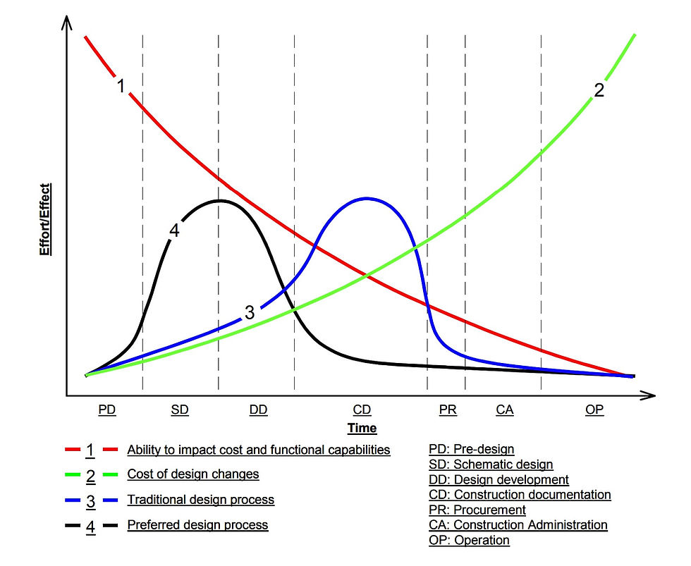

# Session 01: Getting Started With Revit

## Goal

Understand the Revit workspace, open a project, navigate views, and recognise the main tools used during a basic modelling session.

## Prerequisites

- Autodesk Revit installed
- Basic understanding of architectural drawings
- A sample project or Revit default template

## Key Concepts

- BIM vs CAD
- MacLeamy Curve
- Project Browser
- Properties Palette
- Ribbon tools
- View controls
- 3D navigation
- Selection and modification tools
- Basic digital literacy for opening, saving, and finding files

## Demonstration

Introduce Revit as a coordinated BIM model rather than a set of disconnected CAD drawings. Show how plans, sections, elevations, schedules, and sheets all read from the same project model.

### MacLeamy Curve

The MacLeamy Curve is a useful way to explain why BIM changes the design process. It compares the ability to influence project outcomes, the cost of making changes, and where design effort usually happens.

Source: [DDG Global, "MacLeamy Curve - How BIM affects the design process"](https://www.ddg.global/post/macleamy-curve-how-bim-affects-the-design-process).

The key lesson for Revit users is that BIM rewards earlier thinking. Coordinated models, shared information, and earlier collaboration help teams make important decisions while they are still relatively cheap and easy to change.

Then orient learners around the interface:

- Ribbon tabs and panels
- Quick Access Toolbar
- Properties Palette
- Project Browser
- View Control Bar
- Status Bar

## Exercise

1. Open Revit and create a new architectural project.
2. Discuss where Revit shifts effort compared with a traditional drawing-led workflow.
3. Find the Project Browser and Properties Palette.
4. Open a floor plan, elevation, section, and 3D view.
5. Practice zooming, panning, orbiting, and switching between views.
6. Select model elements using click, window selection, tab select, and filters.
7. Use move, copy, rotate, and temporary hide/isolate.
8. Try trim/extend, align, offset, mirror, split, array, scale, pin/unpin, and copy/paste aligned on prepared elements.
9. Save the project locally.

## Checklist

- [ ] I can create or open a Revit project.
- [ ] I can explain why BIM shifts design decisions earlier in the project.
- [ ] I can identify the main interface areas.
- [ ] I can switch between common view types.
- [ ] I can navigate a model in 2D and 3D.
- [ ] I can select and modify basic elements.
- [ ] I can use the core Modify tools listed in the ACU objectives.

## Homework

- Practice navigation shortcuts.
- Open and explore sample projects.
- Duplicate a view and rename it clearly.
