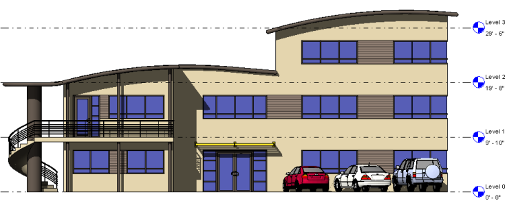
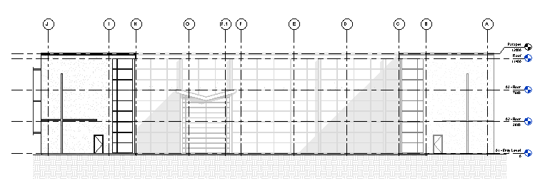
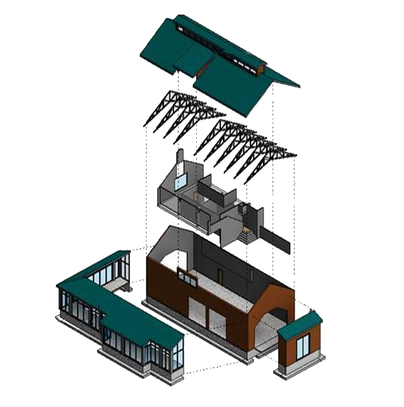

# Session 08: Sections, Elevations and Callouts

## Goal

Generate coordinated construction documentation views from the model.

## Prerequisites

- A simple model with walls, openings, floors, and roof elements
- Basic visibility and annotation knowledge

## Key Concepts

- Section views
- Section extents
- Far clip settings
- Detail level
- Interior elevations
- Exterior elevations
- Crop boundaries
- Callouts
- Reference callouts

## Demonstration

Show how sections and elevations are generated from the model, then explain how extents, crop regions, far clipping, and detail level control what each view shows.

Introduce callouts for enlarged plans and details. Explain the difference between creating a new callout view and referencing an existing view.

## Depth Cueing

Depth cueing helps elevations and sections communicate distance by fading elements that are farther away from the view position. It can improve legibility in deep views where foreground and background elements would otherwise have the same visual weight.

Depth cueing is controlled in the view's Graphic Display Options. Learners should adjust the fade start and end distances carefully, then check that important background geometry remains readable. It is a presentation tool rather than a replacement for good crop regions, far clipping, lineweights, or view organisation.

## Displacement Sets

Displacement sets create exploded or separated representations of model elements within a view without physically moving those elements in the model. They are useful for diagrams, assembly explanations, and presentations that need to show how components relate to each other.

A displacement set is view-specific. The underlying model remains coordinated in its original position, while the selected elements appear displaced only in that view. Displacement paths can be added to show where elements came from. Use displaced views deliberately: they are excellent for explanation, but they should not be mistaken for construction geometry or actual model coordinates.

## Exercise

1. Create a building section.
2. Adjust section extents and far clip settings.
3. Create exterior elevations.
4. Add interior elevations to a room.
5. Create an enlarged plan callout.
6. Create a reference callout.
7. Apply depth cueing to an elevation or section and compare the result.
8. Create a simple displacement set in a 3D view and add displacement paths.
9. Rename and organise the new views.

## Checklist

- [ ] I can create and adjust section views.
- [ ] I can create interior and exterior elevations.
- [ ] I can control crop boundaries.
- [ ] I can create enlarged callouts.
- [ ] I understand reference callouts.
- [ ] I can use depth cueing to improve section or elevation legibility.
- [ ] I understand that displacement sets are view-specific representations.

## Revit Help Links

- [Video: Create Views of Your Model](https://help.autodesk.com/view/RVT/2026/ENU/?guid=GUID-A53A29E3-3A3C-495E-B6F1-C252097D38F5)
- [Sections](https://help.autodesk.com/view/RVT/2026/ENU/?guid=GUID-0B7C5662-43EE-4E96-9140-CB346AF6ED5F)
- [Elevations](https://help.autodesk.com/view/RVT/2026/ENU/?guid=GUID-12D53643-EE94-4556-9409-5E4B534C1E33)
- [Create Elevation Views Tutorial](https://help.autodesk.com/view/RVT/2026/ENU/?guid=GUID-E902C0EC-64CA-45AC-ABA5-5BC63A5E2647)
- [Callouts](https://help.autodesk.com/view/RVT/2026/ENU/?guid=GUID-E9929D3A-ED0B-4478-80E4-C8937A8874EF)
- [Crop regions](https://help.autodesk.com/view/RVT/2026/ENU/?guid=GUID-87B694BA-048C-4190-BA4B-68C136E163E8)
- [Video: Depth Cueing](https://help.autodesk.com/view/RVT/2026/ENU/?guid=GUID-831603AC-F6F4-448F-9892-39E3A30D1E96)
- [Video: Work with Displaced Views](https://help.autodesk.com/view/RVT/2026/ENU/?guid=GUID-3C9F4A48-40DD-4160-B1C3-6100CDA07567)
