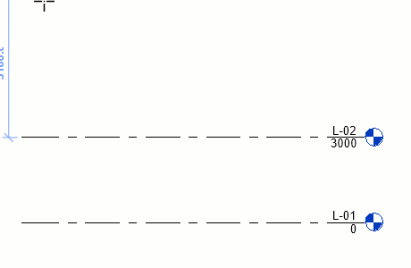

# Session 02: Levels, Grids and Basic Setup

## Goal

Set up the primary datum structure of a Revit project and understand how levels, grids, and views relate to each other.

## Prerequisites

- Session 01 completed
- A new or sample architectural project
- Basic view navigation confidence

## Key Concepts

- Datum elements
- Levels and associated views
- Grids and structural reference systems
- Architectural columns on grids
- Structural columns and coordination intent
- Basic wall placement from grid references
- Datum extents
- Naming consistency
- View organisation

## Demonstration

Explain levels as the vertical control system of the project. Show how building elements can be hosted or constrained to levels, and how renaming a level can also rename the associated plan view.

Then introduce grids as the project reference system used for coordination, dimensioning, and setting out. Show bubble visibility, extents, grid names, and how datum visibility can differ between views. Place architectural columns on grid intersections so learners understand the exam link between grids and columns.

## Architectural and Structural Columns

Revit has both architectural columns and structural columns. They can look similar in a beginner model, but they carry different meaning and are used for different coordination workflows.

Architectural columns are normally used where the column is part of the architectural definition of the space. They may represent a visible finish, casing, boxing-out, pilaster, or column enclosure. They belong to the architectural model and are often useful when the architect needs to control what is seen in plans, sections, elevations, and room layouts.

Structural columns are used when the element represents a load-bearing structural member. They belong to the structural modelling logic and are usually coordinated with the structural engineer. Structural columns have structural behaviour, analytical relevance, and category settings that support structural documentation and coordination.

In practice, an architectural model may show columns for spatial and visual coordination while the structural model contains the authoritative structural columns. In a live project, do not duplicate structural information casually. Agree with the project team whether the architect should model architectural column finishes, structural column placeholders, or rely on linked structural models.

For this training session, place architectural columns on grid intersections to understand the grid-and-column relationship without introducing full structural modelling. The main lesson is that grids provide a shared reference system, and columns often make that reference system visible in the building layout.

## Basic Wall Layout From Grids

This session also introduces simple wall placement so learners can see why levels and grids matter. The aim is not yet to understand wall build-ups, layers, materials, or detailed wall types. That comes in the next session.

For now, use walls as simple layout elements:

- Draw external walls using grids as setting-out references.
- Set the wall base and top constraints to the correct levels.
- Use the location line to decide whether the wall is placed by centreline, finish face, or core face.
- Use temporary dimensions and Align to keep walls coordinated with grids.
- Keep the layout simple enough that the datum structure remains the main focus.

By the end of this session, learners should understand that levels control vertical relationships, grids control setting-out, and walls are easier to manage when they are placed against a clear datum strategy.

## Project Positioning

Revit projects also need a clear positioning strategy. Even in a small training model, learners should understand that the building has an internal coordinate system and that real projects often need to relate to survey, site, and linked consultant models.

The three key reference concepts are:

- Internal Origin: Revit's fixed internal reference point. It should be treated as the stable mathematical origin of the model.
- Project Base Point: the project team's local reference point. It is often used for a meaningful project coordinate such as a setting-out point or agreed local datum.
- Survey Point: the relationship between the Revit project and a real-world survey coordinate system.

For this training course, keep the model close to the internal origin and avoid moving the building very far away. Revit has distance limits, and modelling too far from the internal origin can cause display, snapping, accuracy, and coordination problems. In practice, the team should decide the coordinate strategy at the start of a project rather than after models have already been built.

For now, the exercise is conceptual: identify the project base point, survey point, and internal origin, but do not change the project coordinates unless instructed.

## Exercise

1. Open an elevation view.
2. Create a set of building levels.
3. Rename levels and confirm associated view names.
4. Add grids to a floor plan.
5. Adjust grid bubbles and datum extents.
6. Rename grid bubbles.
7. Create plan views for the required levels using `View > Plan Views > Floor Plan`. Check that each plan view is named clearly and appears in the correct Project Browser location.
8. Place architectural columns on selected grid intersections and discuss how this differs from placing structural columns.
9. Draw a simple external wall layout using the grids as setting-out references.
10. Set wall base and top constraints so the walls relate correctly to the levels.
11. Use Align and temporary dimensions to coordinate wall positions with grids.
12. Align levels and grids so the datum lines read clearly in elevations and plans. Adjust 2D and 3D extents where needed so the documentation is tidy.
13. Create a scope box around the main building area and assign it to relevant plan views. Use it to keep crop regions and datum extents consistent.
14. Identify the internal origin, project base point, and survey point.
15. Review the Project Browser, rename any unclear views, and remove or ignore duplicate views that are not needed for the exercise.

## Checklist

- [ ] I can create and rename levels.
- [ ] I understand that levels can generate plan views.
- [ ] I can place and adjust grids.
- [ ] I can control datum visibility and extents.
- [ ] I can explain the difference between architectural and structural columns.
- [ ] I can place architectural columns on a grid.
- [ ] I can create plan views for levels.
- [ ] I can use a scope box to coordinate view crops and datum extents.
- [ ] I can create a simple wall layout using grids as references.
- [ ] I can constrain simple walls between levels.
- [ ] I can describe the internal origin, project base point, and survey point.
- [ ] I can keep view names and datum names consistent.

## Homework

- Recreate a simple structural grid layout.
- Add three levels to a fresh project and name them clearly.

## Revit Help Links

- [Add Levels and Grids](https://help.autodesk.com/cloudhelp/2026/ENU/Revit-GetStarted/files/GUID-472CE975-AEFC-48A1-8722-E7357F80B90C.htm)
- [Add Levels](https://help.autodesk.com/view/RVT/2025/ENU/?guid=GUID-075B9A47-69AB-44D2-8A05-6136EFF26946)
- [Grids](https://help.autodesk.com/view/RVT/2025/ENU/?guid=GUID-00D47820-7F7E-4677-BADA-A8CBAD614A16)
- [Scope Box](https://help.autodesk.com/view/RVT/2025/ENU/?guid=GUID-57084384-4D1E-498A-A6F9-CE5C7260A088)
- [Columns](https://help.autodesk.com/view/RVT/2026/ENU/?guid=GUID-D28D080E-74DF-4C6D-997D-7B7A8F99C1A2)
- [Walls](https://help.autodesk.com/view/RVT/2026/ENU/?guid=GUID-30D3A26F-42FF-40FA-83D2-B43EA67F3ECD)
- [Positioning the model](https://help.autodesk.com/view/RVT/2026/ENU/?guid=GUID-D5CF2C0C-FFC9-4D2C-BE3F-B85D8EC4AE9D)
- [Project base point, survey point, and internal origin](https://help.autodesk.com/view/RVT/2026/ENU/?guid=GUID-68611F67-ED48-4659-9C3B-59C5024CE5F2)
- [Maximum distance limit](https://help.autodesk.com/view/RVT/2026/ENU/?guid=GUID-3F79BF5A-F051-49F3-951E-D3E86F51BECC)
