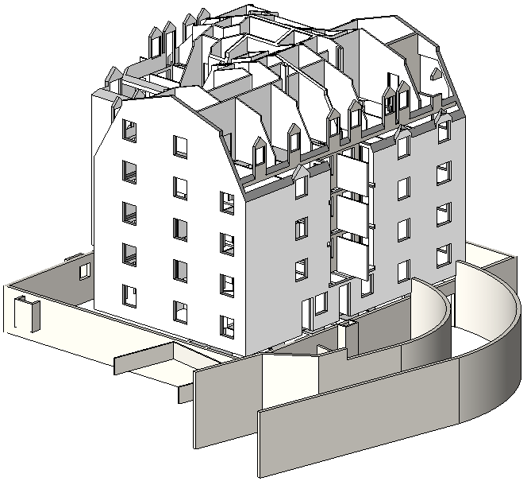

# Session 03: Walls, Doors and Windows

## Goal

Model a simple floor plan using walls, doors, and windows while understanding hosted elements and type versus instance properties.

## Prerequisites

- Session 02 completed
- Project levels and grids available
- Basic selection and modification confidence

## Key Concepts

- Architectural walls
- Wall location lines
- Base and top constraints
- Wall joins
- Hosted doors and windows
- Wall and shaft openings
- Type properties
- Instance properties

## Demonstration

Show how walls are constrained between levels and how their location line affects placement accuracy. Demonstrate wall joins, temporary dimensions, and basic wall type changes.

Then place doors and windows into walls. Explain hosted behaviour, level placement, flip controls, sill heights, head heights, and why deleting a host wall affects hosted components. Demonstrate wall openings and shaft openings as separate opening tools.

This session uses a small amount of loaded content so learners understand the normal Revit workflow for doors and windows. The focus is still on placing and controlling hosted elements, not on building a full family library.

Session 10 will look more closely at where to find appropriate models and families, including office libraries, manufacturer content, and reliable external sources. Session 11 will then introduce the basics of editing and creating families so learners understand how custom content is made.

## Wall Types and Compound Structure

Walls are system families. This means they are created and edited inside the project rather than loaded as separate `.rfa` files. To create a new wall type, duplicate an existing wall type, rename it clearly, and edit its type properties.

The most important setting is the compound structure. A compound wall is built from layers, and each layer can have a function, material, thickness, and position relative to the core. Typical layer functions include structure, substrate, thermal or air layer, finish, and membrane. Revit uses these layer functions when joining walls, dimensioning to core faces, and representing walls in different levels of detail.

Wall location line controls where the wall is placed relative to the line you draw. For example, a wall can be placed by centreline, core centreline, finish face, or core face. This matters when setting out walls from grids, boundaries, or existing geometry.

Wall joins control how walls clean up where they meet. Good wall joins make drawings readable, but they should still be checked in plan and section. Where the automatic join is not appropriate, edit the join condition rather than drawing over it with 2D lines.

Also be aware of related wall tools:

- Wall sweeps add continuous profiles such as skirtings, copings, or bands.
- Wall reveals cut continuous recesses into walls.
- Stacked walls combine different wall types vertically, for example a plinth wall below a different upper wall type.

## Curtain Walls

Curtain walls are a special wall system used for glazed facades, screens, storefronts, and panelised wall assemblies. They are still part of the wall toolset, but they introduce grids, mullions, panels, and different editing behaviour.

For the Autodesk Certified User level, learners should recognise that curtain walls exist and understand that they are not the same as ordinary basic walls. This session can show a short demonstration only: place a simple curtain wall type, add or adjust curtain grids, and point out mullions and panels. Detailed facade design, custom panels, and advanced curtain wall workflows should sit later in the course or in project-specific training.

## Exercise

1. Create a simple rectangular floor plan.
2. Add internal partitions.
3. Adjust wall constraints and location lines.
4. Review wall build-up, type properties, and how changing a wall type differs from moving or constraining a wall instance.
5. Duplicate a wall type, rename it, and edit its compound structure.
6. Change the wall location line and compare the placement result.
7. Review wall joins at corners and intersections.
8. Briefly place a curtain wall type and identify curtain grids, mullions, and panels.
9. Place doors in internal and external walls.
10. Place windows and adjust sill heights.
11. Review head height and placement level.
12. Use flip controls to correct orientation.
13. Load a new window family, such as a sash window, using `Insert > Load Family`. Choose a suitable family from the Revit online library.
14. Place the loaded sash window into an external wall and adjust its sill height, type, and position.
15. Create a wall opening and a shaft opening.
16. Modify one wall type and compare type and instance changes.

## Checklist

- [ ] I can draw walls accurately.
- [ ] I can set base and top constraints.
- [ ] I can identify where wall type build-up is edited.
- [ ] I can duplicate a wall type and edit its compound structure.
- [ ] I can explain wall location line and wall joins.
- [ ] I recognise curtain walls as a special wall system.
- [ ] I can place hosted doors and windows.
- [ ] I can load a new door or window family into the project.
- [ ] I can use flip controls.
- [ ] I can create wall and shaft openings.
- [ ] I understand type versus instance changes.

## Homework

- Create variations of wall types.
- Model a small room layout with at least two doors and four windows.
- Place a simple curtain wall and identify one panel and one mullion.

## Revit Help Links

- [Walls](https://help.autodesk.com/view/RVT/2025/ENU/?guid=GUID-550F4B3E-7D49-4A4F-BEC7-4077D5B9FC85)
- [Doors](https://help.autodesk.com/view/RVT/2025/ENU/?guid=GUID-05A0DA70-E276-4944-ACCA-5702DC8B9DCA)
- [Windows](https://help.autodesk.com/view/RVT/2025/ENU/?guid=GUID-987D9F47-E4C7-4213-8ABE-F61D8CC56D6A)
- [Openings](https://help.autodesk.com/view/RVT/2026/ENU/?guid=GUID-74E575CA-0140-4C5B-B908-4822BBF95857)
- [Compound wall structure](https://help.autodesk.com/view/RVT/2025/ENU/?guid=GUID-08E47F82-BFA1-4CAB-B2EA-6C8DC9049AD8)
- [Layer functions in compound walls](https://help.autodesk.com/view/RVT/2025/ENU/?guid=GUID-1CCD1005-CBDA-4338-8D60-489095D4BB25)
- [Video: compound structure in walls](https://help.autodesk.com/view/RVT/2025/ENU/?guid=GUID-475CF556-2EAE-4D6E-906D-4CE6BBE578D9)
- [Wall joins](https://help.autodesk.com/view/RVT/2025/ENU/?guid=GUID-19EAF7A9-331F-4271-94CC-43B76B13011E)
- [Wall sweeps](https://help.autodesk.com/view/RVT/2025/ENU/?guid=GUID-F3AFA160-FB0B-4DFE-82A1-80F52FA97EF9)
- [Wall reveals](https://help.autodesk.com/view/RVT/2025/ENU/?guid=GUID-517B7AF3-EAB9-4212-95A1-17ADBEA908B7)
- [Stacked walls](https://help.autodesk.com/view/RVT/2025/ENU/?guid=GUID-A470102D-0CD9-4410-9561-DEE4D7C6C057)
- [Door tutorial](https://help.autodesk.com/view/RVT/2026/ENU/?guid=GUID-6CA4C036-034D-4410-A3AB-5CBC492C3A83)
- [Window tutorial](https://help.autodesk.com/view/RVT/2026/ENU/?guid=GUID-27E9FE5D-6B1D-407C-9DBA-36D61F301DAF)
