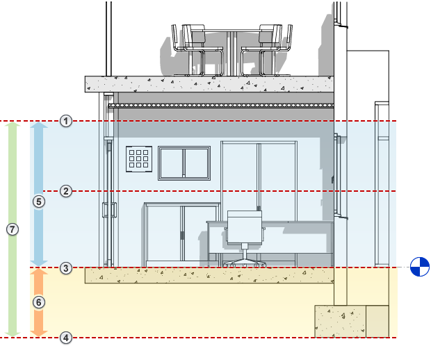

# Session 05: Views, Visibility and Graphics

## Goal

Control how the model appears in different views and troubleshoot common visibility problems.

## Prerequisites

- Sessions 01-04 completed
- A model containing walls, doors, windows, floors, roofs, and ceilings

## Key Concepts

- Visibility/Graphics overrides
- Category visibility
- Temporary hide/isolate
- Detail level
- Visual styles
- Crop regions
- View templates
- View range
- Underlays
- 3D section boxes
- Camera views

## Demonstration

Explain that Revit views are controlled by view-specific settings. Show the hierarchy from category-level visibility to element-level overrides, temporary hide/isolate, and view templates.

Demonstrate common visibility issues and a systematic troubleshooting process covering hidden elements, reveal hidden elements, category overrides, underlays, view range, phases, discipline settings, and linked model visibility.

## Exercise

1. Duplicate a floor plan as a working view.
2. Adjust detail level and visual style.
3. Use Visibility/Graphics overrides.
4. Temporarily hide and isolate elements.
5. Create a simple view template.
6. Apply the template to a second view.
7. Duplicate views using Duplicate, Duplicate with Detailing, and Duplicate as Dependent.
8. Create a 3D view and modify a section box boundary.
9. Create a camera view.
10. Add an underlay to a plan view and use it to compare geometry from another level.
11. Create a plan region where a local area needs a different view range.
12. Diagnose prepared visibility issues.

## View Range

View range controls the vertical slice of the model that appears in a plan view. It is one of the most common reasons why elements appear, disappear, or display differently from what learners expect.

The key settings are:

- Top: the upper limit of the main view range.
- Cut Plane: the height where Revit cuts through model elements.
- Bottom: the lower limit of the main view range.
- View Depth: the additional depth Revit can look beyond the bottom of the primary range.

For a normal floor plan, the cut plane is often around door and window head height. If the cut plane is too low or too high, windows, high-level objects, or low-level elements may not display as expected. When troubleshooting a plan, always check the view range before assuming the model is wrong.

## Family Cut Behaviour

Different Revit categories respond to the cut plane in different ways. This is why two elements at the same height can display differently in the same view.

- Walls usually cut when the cut plane passes through them, showing their wall build-up and cut lineweight.
- Doors and windows are hosted by walls and usually display according to the wall opening, family geometry, sill height, and cut plane relationship.
- Furniture is normally not cut in plan; it usually displays as projection geometry.
- Casework can behave more like furniture or more like model geometry depending on how the family is built.
- Generic models depend heavily on their family category, geometry, and visibility settings, so they are common sources of visibility confusion.

When an object does not display as expected, check its category, family visibility settings, host relationship, and height relative to the view range.

## Plan Regions and Underlays

A plan region allows part of a plan view to use a different view range from the rest of the view. This is useful for split-level areas, stairs, mezzanines, high windows, or local conditions where the standard floor plan cut plane does not show the necessary information.

Underlays let learners see another level or view reference beneath the current plan. They are useful for coordination and comparison, but they should not be confused with live visible model geometry in the active view. Use underlays temporarily to understand relationships between levels, then turn them off or control them carefully in production views.

## Checklist

- [ ] I can use Visibility/Graphics overrides.
- [ ] I can distinguish temporary and permanent hide.
- [ ] I can set detail level and visual style.
- [ ] I can create and apply a view template.
- [ ] I can explain how top, cut plane, bottom, and view depth affect a plan.
- [ ] I can use plan regions for local view range exceptions.
- [ ] I can troubleshoot why an element is not visible.
- [ ] I can control underlays and view range.
- [ ] I can create 3D views, camera views, and duplicated view variants.

## Homework

- Create one working view and one presentation view.
- Write down three visibility checks to try when an element disappears.

## Revit Help Links

- [Visibility and graphics](https://help.autodesk.com/view/RVT/2026/ENU/?guid=GUID-FB8D0ABE-8521-4EA0-A47E-FF3DEBC403A5)
- [View range](https://help.autodesk.com/view/RVT/2026/ENU/?guid=GUID-58711292-AB78-4C8F-BAA1-0855DDB518BF)
- [View templates](https://help.autodesk.com/view/RVT/2026/ENU/?query=view%20templates)
- [3D views and section boxes](https://help.autodesk.com/view/RVT/2026/ENU/?query=3D%20view%20section%20box)
- [Underlays](https://help.autodesk.com/view/RVT/2026/ENU/?guid=GUID-F03617DC-541D-49CF-B40C-B2537175F561)
